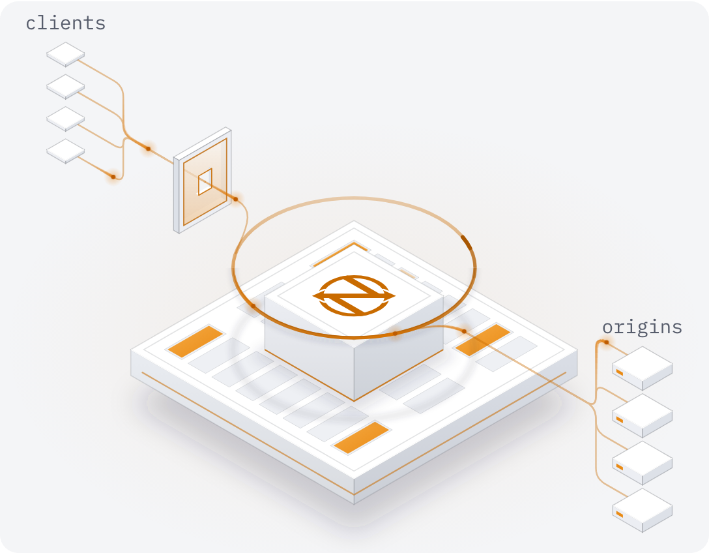

[](https://discord.gg/BGbb7VtYA)

A reverse proxy, a load generator, and the Zig protocol libraries they are built on.

### [zoxy](https://github.com/zoxy-io/zoxy)

<picture>
  <source media="(prefers-color-scheme: dark)" srcset="https://raw.githubusercontent.com/zoxy-io/.github/main/profile/engine-dark.png">
  
</picture>

A zero-allocation reverse proxy and load balancer. All memory is reserved at
startup, the serving path never allocates, and under overload it sheds the
newest work instead of falling over.

[zoxy.io](https://zoxy.io) · [Documentation](https://zoxy.io/docs/) ·
[Configuration reference](https://zoxy.io/config/) ·
[Benchmark against haproxy, nginx, pingora and envoy](https://zoxy.io/bench/)

### [zrk](https://github.com/zoxy-io/zrk)

A constant-throughput HTTP load generator: a rewrite of wrk2 that paces every
send in nanoseconds and corrects for coordinated omission, over HTTP/1.1,
HTTP/2 or HTTP/3.

[zoxy.io/zrk](https://zoxy.io/zrk/)

```sh
brew install zoxy-io/tap/zoxy
brew install zoxy-io/tap/zrk
```

### Libraries

| | | Used by |
|---|---|---|
| [hparse](https://github.com/zoxy-io/hparse) | Streaming SIMD HTTP parser, zero-allocation | zoxy, zurl |
| [hpack](https://github.com/zoxy-io/hpack) | HPACK (RFC 7541) header compression for HTTP/2, and the primitives HTTP/3 borrows | h2, h3 |
| [h2](https://github.com/zoxy-io/h2) | HTTP/2 frame codec and field validation, zero-allocation | zoxy, zrk |
| [h3](https://github.com/zoxy-io/h3) | QUIC and HTTP/3, zero-allocation, with no socket or TLS engine of its own | zrk |
| [zssl](https://github.com/zoxy-io/zssl) | Sans-I/O TLS 1.3 over libcrypto primitives | zoxy, zrk |
| [zurl](https://github.com/zoxy-io/zurl) | `std.Io`-native HTTP client | zrk |

[benchmark](https://github.com/zoxy-io/benchmark) is the harness behind
[zoxy.io/bench](https://zoxy.io/bench/): every proxy gets the same open-loop
load ramp until it stops keeping up.
